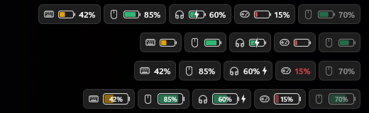

# BatteryWidget

[](https://github.com/hitzjano/BatteryWidget/actions/workflows/ci.yml)
[](https://github.com/hitzjano/BatteryWidget/releases)
[](LICENSE)


Battery levels of your wireless mouse, keyboard, headset and controller, right in the
Windows taskbar. One small native executable: no installer, no service, no driver, no
account, no telemetry.




*Screenshots show the built-in sample devices (`--demo`).*

> **Project status: 0.1.2, early.** The application itself is tested on Windows 11 and
> the protocol logic is covered by unit tests, but the device protocols have not yet
> been verified on real hardware. See
> [Supported devices](#supported-devices) and please [report](CONTRIBUTING.md) what works.

## Features

- **Taskbar widget**: a borderless, transparent strip with one pill per device (icon,
  battery, percentage). It never takes focus, hides behind full-screen apps and only
  uses the gap the taskbar buttons leave free (extra devices collapse into "+N", weakest
  batteries stay visible). It sizes itself to the taskbar, so it also fits a compact
  taskbar with small buttons.
- **Tray icon** that shows the lowest battery level at a glance; every setting lives in
  its context menu.
- **Many sources, one list**: Bluetooth, Logitech receivers, Logitech G HUB, gaming
  peripherals of several brands and game controllers are merged and de-duplicated.
- **Hot-plug**: devices appear and disappear as they connect; sleeping devices keep
  their last level, dimmed.
- **Notifications** for low battery and (optionally) full charge.
- **Windows 11 native**: per-monitor DPI aware, follows dark/light theme, multi-monitor.
- **Light**: under 1 MB on disk, event driven, draws only when something changes.
- **Private**: no network access except the optional G HUB socket on `127.0.0.1`.
  Devices are only ever *asked* for their battery level, never configured.

## Installation

### PowerShell

```powershell
irm https://raw.githubusercontent.com/hitzjano/BatteryWidget/main/install.ps1 | iex
```

Downloads the newest release, verifies its SHA-256 checksum, installs it to
`%LOCALAPPDATA%\Programs\BatteryWidget`, adds a Start menu shortcut and starts it. From
then on it starts with Windows (untick *Start with Windows* in the tray menu to stop that).
No admin rights needed; run it again to update. See [`install.ps1`](install.ps1).

### Download

1. Get `BatteryWidget.exe` from the [latest release](https://github.com/hitzjano/BatteryWidget/releases/latest).
2. Put it anywhere (for example `%LOCALAPPDATA%\Programs\BatteryWidget\`) and run it.
3. It starts with Windows from then on; to turn that off, untick **Start with Windows**
   in the tray icon's menu.

The executable is not code-signed, so SmartScreen may ask for confirmation on first
start. A SHA-256 checksum is published with every release.

### Build from source

Requires [Rust](https://rustup.rs) 1.85 or newer on Windows 10/11.

```powershell
git clone https://github.com/hitzjano/BatteryWidget.git
cd BatteryWidget
cargo build --release
# → target\release\BatteryWidget.exe
```

Cross-compiling from Linux works too (this needs `mingw-w64`):

```sh
rustup target add x86_64-pc-windows-gnu
cargo build --release --target x86_64-pc-windows-gnu
```

## Usage

Start `BatteryWidget.exe`. A battery icon appears in the notification area and, as soon
as a device with a known level is found, the widget appears in the taskbar.

| Action | Result |
| --- | --- |
| Left-click the tray icon | Show or hide the widget |
| Right-click the tray icon or the widget | Device list and settings |
| *Position* → *Free*, then drag the widget | Place it anywhere |

Settings in the menu (it stays open while you change them; click outside to close):

| Setting | Options |
| --- | --- |
| Position | Next to the tray (default), taskbar left (after the weather button, if shown), four screen corners, free |
| Display | Which monitor to use (shown with more than one display) |
| Style | Icon + battery + percentage (default), icon + battery, icon + percentage, icon + battery with the percentage inside |
| Theme | Match Windows, dark, light |
| Show device names | Adds the name to each pill; names are shortened and devices collapse into "+N" if space runs out |
| Notifications | Battery low, fully charged, low threshold 10 to 30 % |
| Sources | Switch each device source on or off |
| Start with Windows | Per-user autostart entry, on by default (switched on at the first start) |

Settings are stored in `%LOCALAPPDATA%\BatteryWidget\config.json`; a log is written to
`app.log` in the same folder (`--verbose` for more detail). `--demo` shows sample
devices instead of scanning, which is handy for screenshots and UI work. A few values exist only in
the file, for example `offset_x` to nudge the widget sideways inside the taskbar.

To uninstall, switch off *Start with Windows*, exit, and delete the executable and the
settings folder.

## Supported devices

Status legend: **Implemented** means the protocol is implemented and unit-tested against
its specification, but not yet confirmed on hardware by the maintainers.

| Source | Devices | Status |
| --- | --- | --- |
| Bluetooth (Classic and LE) | Anything whose battery Windows shows under *Bluetooth & devices*: headphones, mice, keyboards, pens, controllers | Implemented |
| Logitech HID++ 2.0 | Devices on Logi Bolt, Unifying and LIGHTSPEED receivers, wired and Bluetooth devices (MX, G and PRO series, LIGHTSPEED headsets) | Implemented |
| Logitech HID++ 1.0 | Older Unifying devices | Implemented |
| Logitech G HUB | Everything G HUB lists, while G HUB is running | Implemented |
| PlayStation | DualSense, DualSense Edge, DualShock 4 (USB, Bluetooth, Sony adapter) | Implemented |
| Xbox | Controllers known to `Windows.Gaming.Input` / XInput | Implemented |
| Razer | Wireless mice and keyboards using the 90-byte report protocol | Implemented |
| Corsair | Void / HS / Virtuoso headsets, Slipstream (Bragi) mice and keyboards | Implemented |
| HyperX | Cloud II Wireless, Cloud Stinger 2 Wireless, Cloud Alpha Wireless, Cloud III Wireless, Pulsefire Dart | Implemented |
| SteelSeries | Arctis 1 Wireless, Arctis 7, Arctis Nova 7 | Implemented |

Good to know:

- Bluetooth levels come from Windows and are often coarse (steps of 10 or 25 %). Windows
  does not report whether a Bluetooth device is charging; a rising level is shown as
  charging (estimated).
- Vendor software (G HUB, iCUE, Synapse, …) may hold a receiver exclusively. BatteryWidget
  then leaves that receiver alone and retries later.
- Not supported yet: devices whose protocol is not publicly documented well enough to
  query them safely. Requests with details are welcome.

Protocol details are in [docs/PROTOCOLS.md](docs/PROTOCOLS.md).

## How it works

```
crates/core   battery-widget-core: all device logic, no UI
  ├─ bluetooth, hidpp, ghub, vendor   protocol logic (pure, unit-tested on any OS)
  ├─ win/                             Windows I/O: HID, WinRT enumeration, controllers
  ├─ merge                            fusion of all sources into one device list
  └─ hub                              one worker thread per source → channel → snapshots
crates/app    battery-widget: tray icon, Direct2D widget window, settings
```

Each source runs on its own thread and sends complete readings through a channel. An
aggregator merges them and hands the UI an immutable snapshot, only when something
changed. The UI thread owns a single layered window and never blocks on a device.

## Development

```powershell
cargo test --workspace
cargo clippy --workspace --all-targets -- -D warnings
cargo fmt --all
```

The unit tests need no hardware and also run on Linux and macOS. See
[CONTRIBUTING.md](CONTRIBUTING.md) for how to add a device.

## Acknowledgements

Protocol knowledge comes from public documentation and the work of open-source
projects, in particular [Solaar](https://github.com/pwr-Solaar/Solaar) (Logitech HID++),
[OpenRazer](https://github.com/openrazer/openrazer) and
[HeadsetControl](https://github.com/Sapd/HeadsetControl).

BatteryWidget is an independent project and is not affiliated with or endorsed by any
of the hardware vendors mentioned. All product names are trademarks of their owners.

## License

[MIT](LICENSE)
